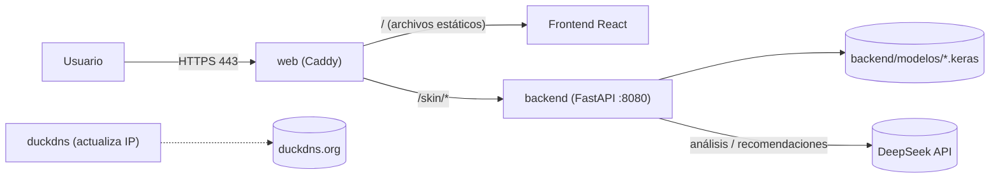

[](LICENSE)

<div align="center">

# PielSana IA


</div>

## Cuidando tu piel con inteligencia artificial

La piel es el órgano más grande de nuestro cuerpo y su salud es fundamental para nuestro bienestar físico y emocional. Sin embargo, muchas personas no tienen acceso fácil a un dermatólogo o a herramientas confiables para evaluar el estado de su piel.
**PielSana IA** nace con la misión de acercar la tecnología de inteligencia artificial a la vida cotidiana, permitiendo que cualquier persona pueda analizar el estado de su piel de manera rápida, privada y sencilla, desde cualquier lugar.

Nuestra plataforma ayuda a detectar y monitorear condiciones cutáneas frecuentes como el acné, la rosácea, los lunares y las manchas solares. Así, buscamos empoderar a los usuarios para que tomen decisiones informadas sobre su salud y, si es necesario, consulten a un profesional con mayor información.

> ⚠️ PielSana IA es una herramienta educativa y de apoyo. **No reemplaza el diagnóstico de un médico.**

---

## Tabla de Contenido

- [¿Cómo funciona PielSana IA?](#cómo-funciona-pielsana-ia)
- [Análisis inteligente con DeepSeek](#análisis-inteligente-con-deepseek-)
- [Casos de Uso](#casos-de-uso)
- [Características Técnicas](#características-técnicas)
- [Estructura del Monorepo](#estructura-del-monorepo)
- [Arquitectura](#arquitectura)
- [Variables de entorno](#variables-de-entorno)
- [Desarrollo local](#desarrollo-local)
- [Despliegue en VPS (Contabo + DuckDNS)](#despliegue-en-vps-contabo--duckdns)
- [API](#api)
- [Modelos locales](#modelos-locales)
- [FAQ](#faq---preguntas-frecuentes)
- [Privacidad](#política-de-privacidad)
- [Contribución, Licencia y Contacto](#contribución)

---

## ¿Cómo funciona PielSana IA?

1. **Elegís el tipo de análisis** (lunares, acné, rosácea o análisis general con IA) y **subís una foto** de la zona de interés.
2. **La imagen se analiza** con un modelo local de visión (CNN entrenada con Keras) o con el modelo multimodal de DeepSeek.
3. **Recibís un informe inmediato** con la condición detectada, las probabilidades y recomendaciones generales de cuidado.

> **Privacidad:** las imágenes se procesan en memoria y no se guardan. En el análisis con IA, la imagen se envía a la API de DeepSeek para procesarla.

---

## Análisis inteligente con DeepSeek 🧠✨

Integramos un **LLM (Modelo de Lenguaje Grande)** a través de la API de [DeepSeek](https://api-docs.deepseek.com/) para enriquecer los resultados de los modelos locales.

### ¿Por qué?
Los modelos de clasificación de imágenes detectan patrones visuales muy bien, pero su salida es limitada: una etiqueta (ej. "Con acné") y un porcentaje de confianza. Eso deja al usuario con dudas sobre qué significa el resultado o qué hacer.

### ¿Para qué?
El LLM "traduce" esos datos técnicos en información útil y humana:
- **Explicaciones claras** de la condición detectada, en lenguaje sencillo.
- **Contexto educativo** sobre causas y síntomas comunes.
- **Recomendaciones generales** de cuidado y prevención (siempre recordando que NO sustituye a un médico).

Se usa de dos maneras:
| Uso | Endpoint | Modelo |
|-----|----------|--------|
| Recomendaciones a partir de la predicción del modelo local | `POST /skin/api/recomendaciones` | `deepseek-flash` (texto) |
| Análisis directo de la imagen | `POST /skin/api/analyze-ia` | `deepseek-flash` (acepta imágenes) |

---

## Casos de Uso

- Autoevaluación y monitoreo de condiciones cutáneas.
- Apoyo para la consulta dermatológica, llevando información objetiva al profesional.
- Seguimiento de la evolución de lesiones o tratamientos.
- Herramienta educativa para conocer más sobre la salud de la piel.

### Condiciones analizadas

- **Lunares:** clasificación de 7 tipos de lesiones pigmentadas (dataset HAM10000).
- **Acné:** detección binaria con / sin acné.
- **Rosácea:** detección binaria con / sin rosácea.
- **Análisis general con IA:** identificación abierta de la afección (incluye manchas solares) con DeepSeek.

---

## Características Técnicas

- **IA híbrida:** redes neuronales convolucionales (CNN) locales para visión por computadora + LLM de DeepSeek para interpretación y generación de texto.
- **Frontend:** React + Vite + TypeScript + TailwindCSS, con modo oscuro.
- **Backend:** API en FastAPI que recibe las imágenes y ejecuta los modelos.
- **Despliegue:** Docker Compose con Caddy (HTTPS automático) en una VPS, con dominio DuckDNS.
- **Privacidad:** procesamiento en memoria, sin base de datos ni almacenamiento de imágenes.

| Capa            | Tecnología                                          |
|-----------------|-----------------------------------------------------|
| Frontend        | React 18, Vite, TypeScript, TailwindCSS, React Router |
| Backend         | Python 3.10, FastAPI, TensorFlow/Keras, SDK `openai` (apuntando a DeepSeek) |
| IA externa      | DeepSeek API (`deepseek-flash`)                      |
| Modelos locales | `lunares.keras`, `acne.keras`, `rosacea.keras`       |
| Infraestructura | Docker Compose, Caddy, DuckDNS, VPS Contabo          |

---

## Estructura del Monorepo

```
PielSanaIA-MVP/
├── frontend/                  ← React + Vite (SPA)
│   ├── src/
│   │   ├── components/        ← Navbar, ImageUploader, ConditionsOverview...
│   │   ├── api/client.ts      ← única puerta al backend (ENDPOINTS, ApiError)
│   │   ├── hooks/             ← useRecommendations
│   │   ├── pages/             ← Home, About, ConditionInfo, Results (acné/rosácea/lunares), ResultsIA
│   │   └── main.tsx / App.tsx ← entrypoint y rutas
│   ├── public/
│   └── package.json
├── backend/                   ← API FastAPI
│   ├── main.py                ← app, CORS y registro de routers
│   ├── controllers/skin.py    ← endpoints /skin/*
│   ├── services/              ← inferencia con los modelos Keras
│   ├── config/model_config.py ← rutas de modelos y ajustes de TensorFlow
│   ├── modelos/               ← modelos .keras (NO versionados, se suben aparte)
│   ├── requirements.txt
│   └── Dockerfile
├── deploy/                    ← despliegue en VPS
│   ├── Caddyfile              ← HTTPS + proxy /skin/* + fallback SPA
│   ├── web.Dockerfile         ← build del front + Caddy
│   ├── setup-vps.sh           ← preparación inicial de la VPS
│   └── deploy.sh              ← actualizar la app
├── docs/AUDITORIA.md          ← auditoría de arquitectura y avance
├── docker-compose.yml
├── .env.example
└── README.md
```

---

## Arquitectura



| Servicio  | Qué hace |
|-----------|----------|
| `web`     | Caddy: sirve el build de Vite, hace proxy de `/skin/*` al backend y obtiene/renueva el certificado Let's Encrypt. |
| `backend` | La imagen de `backend/Dockerfile`. No expone puertos al exterior; los modelos se montan como volumen. |
| `duckdns` | Mantiene el subdominio apuntando a la IP de la VPS. |

---

## Variables de entorno

Plantilla en [`.env.example`](.env.example). Copiala a `.env` en la raíz (nunca la subas al repo).

| Variable | Para qué | Ejemplo |
|----------|----------|---------|
| `DOMAIN` | Dominio público (Caddy y build del front) | `pielsana.duckdns.org` |
| `DUCKDNS_SUBDOMAIN` | Subdominio de DuckDNS | `pielsana` |
| `DUCKDNS_TOKEN` | Token de tu cuenta de DuckDNS | — |
| `DEEPSEEK_API_KEY` | Clave de la API de DeepSeek (obligatoria para las funciones de IA) | `sk-...` |
| `LLM_MODEL` | Opcional. Modelo de DeepSeek | `deepseek-flash` (default) |
| `LLM_BASE_URL` | Opcional. URL de la API compatible con OpenAI | `https://api.deepseek.com` (default) |
| `ALLOWED_ORIGINS` | Orígenes CORS permitidos, separados por coma. Vacío = cualquiera | `https://pielsana.duckdns.org` |
| `RATE_LIMIT_IA` | Opcional. Límite por IP de los endpoints de IA (sintaxis de slowapi) | `10/minute` (default) |
| `MAX_IMAGE_MB` | Opcional. Tamaño máximo de imagen aceptado | `5` (default) |
| `LUNARES_MODEL_PATH`, `ACNE_MODEL_PATH`, `ROSACEA_MODEL_PATH` | Opcional. Rutas alternativas a los modelos | — |

Si falta `DEEPSEEK_API_KEY` o DeepSeek no responde, los endpoints de IA devuelven `503 Servicio de IA no disponible`. Los análisis con modelos locales siguen funcionando.

---

## Desarrollo local

**Requisitos:** Python 3.10, Node.js 18+, y opcionalmente Docker.

### Backend

Se ejecuta **desde la raíz del repo**, porque los imports son `backend.*`:

```bash
python3.10 -m venv venv
source venv/bin/activate
pip install -r backend/requirements.txt
cp .env.example .env          # completar DEEPSEEK_API_KEY
uvicorn backend.main:app --reload --port 8080
```

La API queda en http://localhost:8080 y la documentación interactiva en http://localhost:8080/docs.
Para los análisis locales, copiá los `.keras` en `backend/modelos/` (ver [Modelos locales](#modelos-locales)).

### Frontend

```bash
cd frontend
echo "VITE_API_URL=http://localhost:8080" > .env.local
npm install
npm run dev
```

La interfaz queda en http://localhost:5173.

### Todo junto con Docker (igual que en producción)

```bash
cp .env.example .env    # poné DOMAIN=localhost
docker compose up --build
```

Abrí https://localhost. Caddy usa un certificado local, así que el navegador va a mostrar una advertencia la primera vez.

---

## Despliegue en VPS (Contabo + DuckDNS)

Toda la app (frontend + backend) corre en una VPS con Docker Compose, bajo `https://<subdominio>.duckdns.org` con HTTPS automático.

1. **DuckDNS:** en [duckdns.org](https://www.duckdns.org) creá el subdominio, poné la IP pública de la VPS y copiá el *token*.
2. **Preparar la VPS** (como root, una sola vez): instala Docker, crea el usuario `deploy`, configura el firewall (22/80/443), agrega swap y clona el repo.
   ```bash
   ssh root@IP_VPS
   curl -fsSL https://raw.githubusercontent.com/thejoresp/PielSanaIA-MVP/main/deploy/setup-vps.sh | bash
   ```
   > Si entrás a root con contraseña (sin clave SSH), el usuario `deploy` no va a tener acceso por SSH. Antes de seguir, desde tu máquina corré `ssh-copy-id root@IP_VPS` y volvé a ejecutar el script, o usá `su - deploy` desde root.
3. **Variables de entorno:** `nano /home/deploy/PielSanaIA-MVP/.env` → `DOMAIN`, `DUCKDNS_SUBDOMAIN`, `DUCKDNS_TOKEN`, `DEEPSEEK_API_KEY`, `ALLOWED_ORIGINS`.
4. **Subir los modelos** (no están en el repo), desde tu máquina:
   ```bash
   scp lunares.keras deploy@IP_VPS:~/PielSanaIA-MVP/backend/modelos/ham10000/
   scp acne.keras    deploy@IP_VPS:~/PielSanaIA-MVP/backend/modelos/acne/
   scp rosacea.keras deploy@IP_VPS:~/PielSanaIA-MVP/backend/modelos/rosacea/
   ```
5. **Levantar:**
   ```bash
   ssh deploy@IP_VPS
   cd PielSanaIA-MVP && docker compose up -d --build
   ```
6. **Actualizar** después de un `git push`: `./deploy/deploy.sh` en la VPS.

### Comprobar

```bash
docker compose ps                     # 3 servicios en "running"; backend "(healthy)" tras ~1 min
docker compose logs -f web            # emisión del certificado
docker compose logs -f backend        # errores de la API / carga de modelos
curl -I https://<sub>.duckdns.org/          # el front responde 200
```

> Los puertos 80 y 443 tienen que estar libres y accesibles desde Internet para que Let's Encrypt emita el certificado.

---

## API

Todas las rutas cuelgan de `/skin` (además, `GET /` del backend es un health interno que responde `{"status": "ok"}`; Caddy no lo expone). La documentación completa está en `/docs` (Swagger) del backend.

| Método | Ruta | Descripción |
|--------|------|-------------|
| `POST` | `/skin/api/analyze-lunares` | Clasifica un lunar (multipart `file`) |
| `POST` | `/skin/api/analyze-acne` | Detecta acné (multipart `file`) |
| `POST` | `/skin/api/analyze-rosacea` | Detecta rosácea (multipart `file`) |
| `POST` | `/skin/api/analyze-ia` | Análisis directo de la imagen con DeepSeek (multipart `file`) |
| `POST` | `/skin/api/recomendaciones` | Descripción y recomendaciones con DeepSeek. Body: `{"prediccion": "Con acné"}` |

- Las imágenes se validan en todos los endpoints: `400` si no es una imagen y `413` si supera `MAX_IMAGE_MB`.
- Los dos endpoints de IA tienen rate limit por IP (`429` al superar `RATE_LIMIT_IA`); `prediccion` admite hasta 100 caracteres (`422`). Si DeepSeek no responde o falta la clave, devuelven `503`.
- El contenido educativo de cada condición (causas, síntomas, tratamiento) vive en el front: `frontend/src/data/conditions.ts`.
- **Tope de gasto:** además del rate limit, configurá un límite de gasto en el panel de DeepSeek.

**Ejemplo — análisis de acné**

```http
POST /skin/api/analyze-acne
Content-Type: multipart/form-data

file: imagen.jpg
```

```json
{
  "filename": "imagen.jpg",
  "content_type": "image/jpeg",
  "prediccion": "Con acné",
  "probabilidades": { "Con acné": 0.91, "Sin acné": 0.09 }
}
```

**Ejemplo — recomendaciones con DeepSeek**

```bash
curl -X POST https://<sub>.duckdns.org/skin/api/recomendaciones \
  -H 'Content-Type: application/json' -d '{"prediccion":"Con acné"}'
```

```json
{
  "descripcion": "El acné es...",
  "recomendaciones": ["Lavar el rostro dos veces al día", "..."]
}
```

---

## Modelos locales

Los modelos `.keras` **no se versionan** (están en `.gitignore` y `.dockerignore`). Hay que copiarlos a mano, y el contenedor los toma como volumen:

| Modelo | Ruta esperada | Salida |
|--------|---------------|--------|
| Lunares (HAM10000) | `backend/modelos/ham10000/lunares.keras` | Queratosis Actínica, Carcinoma Basocelular, Queratosis Benigna, Dermatofibroma, Melanoma, Lunar Común (Nevus), Lesión Vascular |
| Acné | `backend/modelos/acne/acne.keras` | Con acné / Sin acné |
| Rosácea | `backend/modelos/rosacea/rosacea.keras` | Con rosácea / Sin rosácea |

Los modelos se cargan la primera vez que se usan. Si falta un archivo, ese análisis devuelve error 500 y los demás siguen funcionando.

---

## FAQ - Preguntas Frecuentes

**¿Se almacenan mis imágenes?**
No. Se procesan en memoria y se descartan. En el análisis con IA, la imagen se envía a DeepSeek para procesarla.

**¿Puedo usar mis propios modelos?**
Sí. Cambiá las rutas con `LUNARES_MODEL_PATH`, `ACNE_MODEL_PATH` o `ROSACEA_MODEL_PATH`, o agregá un nuevo servicio en `backend/services/`.

**¿Puedo usar otro LLM?**
Sí, cualquier API compatible con OpenAI: cambiá `LLM_BASE_URL`, `LLM_MODEL` y la clave.

**¿Qué limitaciones tiene?**
Solo clasifica las condiciones soportadas y los resultados son orientativos: no constituyen un diagnóstico médico.

---

## Política de Privacidad

Este proyecto procesa imágenes de manera temporal y no almacena datos personales. El análisis con IA envía la imagen a un proveedor externo (DeepSeek). Al desplegarlo públicamente se recomienda publicar una política de privacidad detallada que lo informe.

---

## Contribución

¿Te gustaría colaborar? Hacé un fork, creá tu rama, realizá tus cambios y abrí un Pull Request. ¡Toda ayuda es bienvenida!

## Reconocimientos y Créditos

[FastAPI](https://fastapi.tiangolo.com/) · [React](https://react.dev/) · [Vite](https://vitejs.dev/) · [TailwindCSS](https://tailwindcss.com/) · [TensorFlow](https://www.tensorflow.org/) · [Keras](https://keras.io/) · [DeepSeek](https://www.deepseek.com/) · [Caddy](https://caddyserver.com/)

## Licencia y Contacto

Este proyecto está bajo licencia MIT.
- Nombre: Jorge Espinola
- Email: yorluis@hotmail.com
- GitHub: [github.com/thejoresp](https://github.com/thejoresp)
